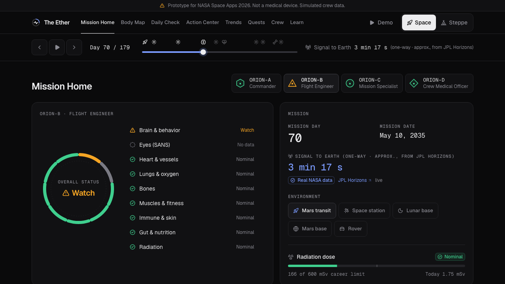
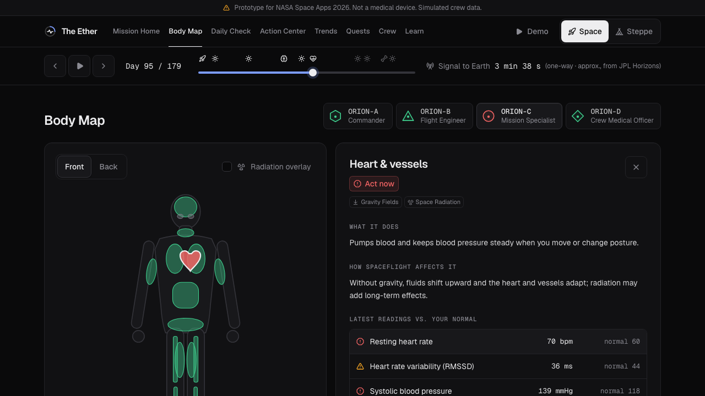
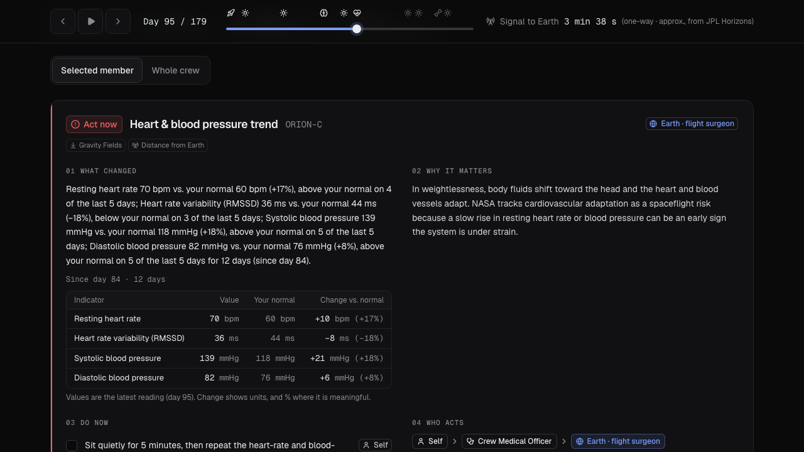
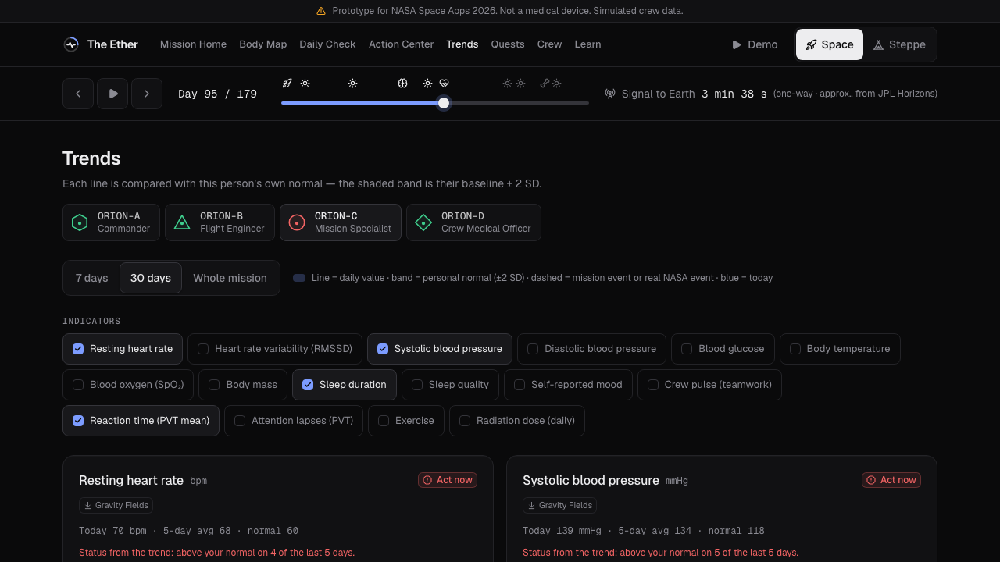
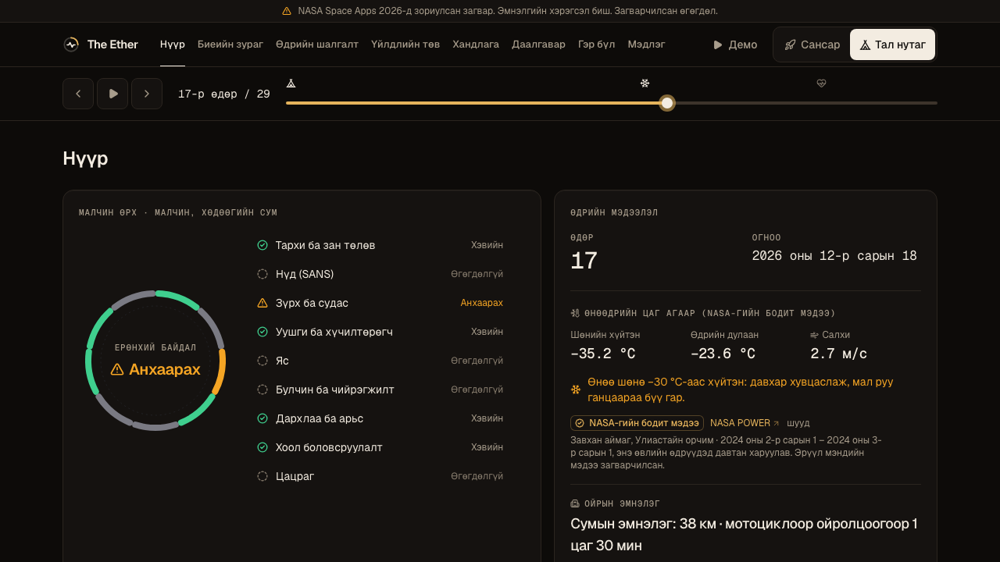
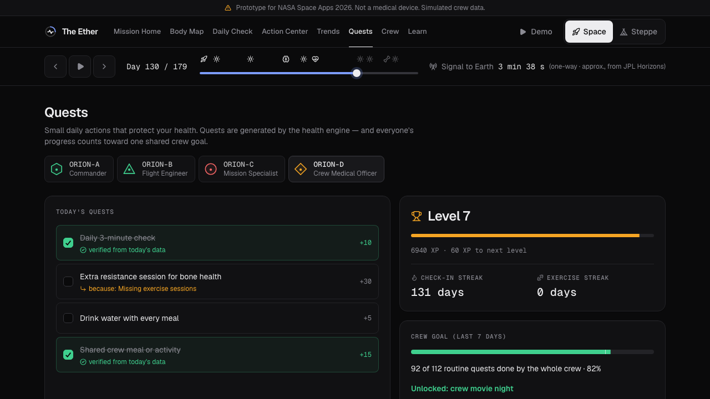
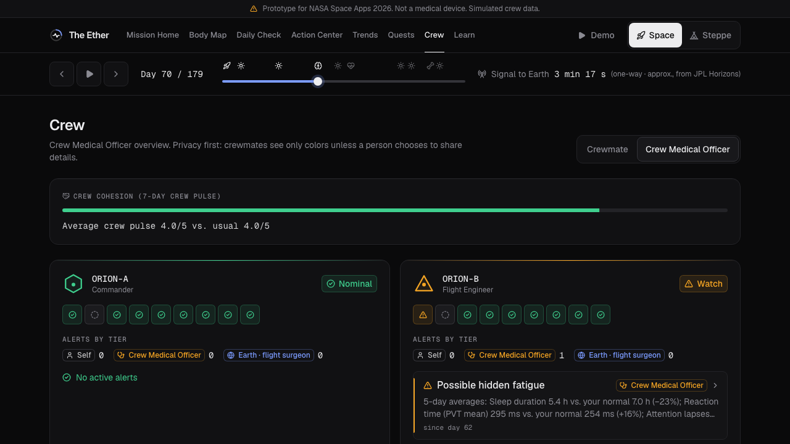
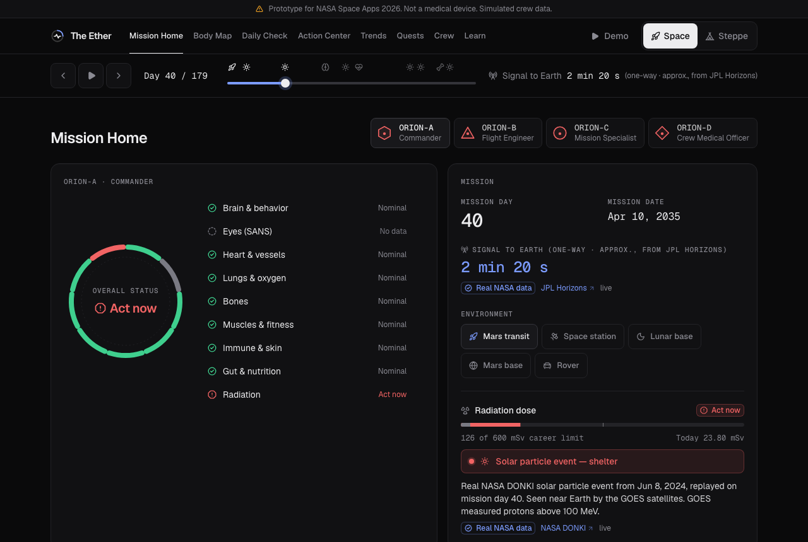
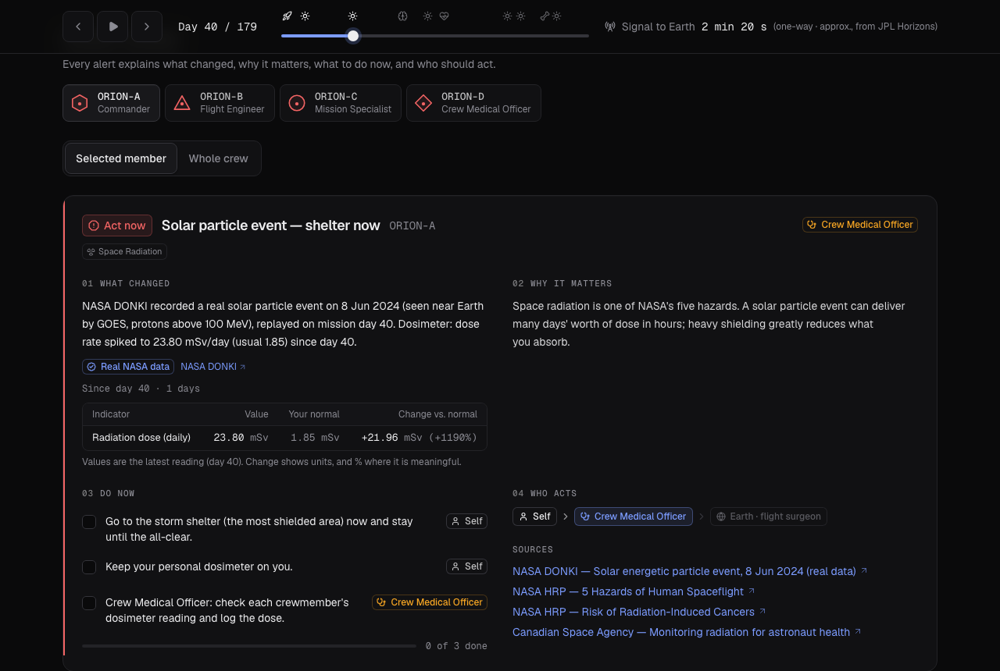
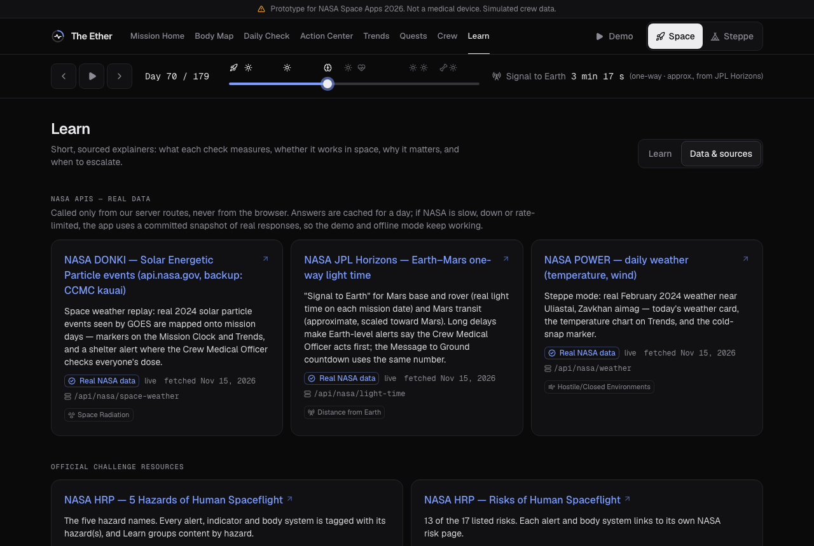

# The Ether

**Your body's early-warning system when the doctor is 20 light-minutes away.**

The Ether is a health self-assessment app for astronauts on long missions. It learns each crewmember's own normal, catches slow "silent" drift, explains it in plain language, and says exactly what to do and who should act: the astronaut, the Crew Medical Officer, or the flight surgeon on Earth. One toggle turns the same engine into a Mongolian-language tool for herders who live hours from the nearest hospital.

Built by team **The Ether** (Ulaanbaatar, Mongolia) for the **NASA Space Apps Challenge 2026**, challenge *"Create Health Monitoring Software for Astronauts on Space Missions."*

> ⚠️ Prototype for NASA Space Apps 2026. **Not a medical device.** All crew data is simulated.

**Live demo:** _LIVE_URL_ · **Repository:** https://github.com/NASA-space-app-chalange-hackathon/The-Ether



## The problem

On a Mars mission the dangerous health problems are rarely sudden. They are slow drifts: sleep shrinking night by night, blood pressure creeping up, bones thinning when exercise is skipped. Astronauts may not notice these changes, or may not admit them. Today's approaches compare people with population averages, rely on self-report, and send data to doctors on Earth who are minutes of light-delay away. NASA's Human Research Program groups the causes into five hazards: radiation, isolation and confinement, distance from Earth, gravity fields, and hostile or closed environments.

## The solution: 5 pillars

| Pillar | What The Ether does |
| --- | --- |
| **Know your normal** | A personal baseline per astronaut per indicator (median + MAD from the first 14 days), updated slowly and frozen during alerts. |
| **Catch the silent drift** | Alerts need a change that *persists* (3 of the last 5 days) or a crossed safety threshold. A **behavioral-drift** signal flags possible under-reporting when sleep and reaction time worsen while self-reported mood stays "fine". |
| **Explain → Act → Escalate** | Every alert shows *what changed* (with the triggering readings), *why it matters* (the NASA HRP risk), *what to do now*, and *who acts*: **SELF → CMO → EARTH**. The **Message to Ground** composer shows the real one-way signal delay with a live countdown. |
| **No hardware needed** | A **30-second camera pulse check** (rPPG, processed on the device), a **1-minute reaction-time test** (PVT-lite), and quick manual vitals. |
| **Healthy as a crew** | Health quests generated from the engine, streaks, and a **cooperative** crew goal (no leaderboard ranking), plus a daily *crew pulse* that addresses NASA's Risk of Inadequate Teamwork. |

**Hero feature: the ⏱ Mission Clock.** Drag the timeline from day 0 to 179 and the whole app moves with it: body colors, alerts, charts and quests, with event markers ☀️ 🧠 🫀 🦴.

**Story twist: 🚀 Space ↔ 🐎 Steppe.** The same engine serves a herder household in rural Mongolia: Mongolian UI, Earth risks (cold, altitude, isolation, distance to the soum hospital), and an Earth escalation ladder (self → family doctor → soum hospital / 103).

## Features

- **Mission Home**: a status ring per body system, crew switcher, mission day, environment selector (transit / station / lunar base / Mars base / rover), signal delay, radiation meter vs. the 600 mSv career limit, top alerts, and today's quests.
- **Body Map**: an abstract front/back SVG figure with 9 regions colored by the engine; works with mouse, touch and keyboard. Each region's panel covers function, spaceflight effect, NASA HRP risk links, latest readings vs. normal, a 30-day trend with the baseline band, and actions.
- **Daily 3-Minute Check**: camera heart rate → reaction test → BP, glucose, temperature, SpO₂, body mass → sleep → mood and crew pulse. Each step has a "Why this test?" with sources. The engine re-runs live.
- **Action Center**: explainable alert cards, a tickable checklist, the escalation ladder, sources, and the Message to Ground composer with its delay countdown.
- **Trends**: multi-indicator charts with personal baseline bands, mission-event annotations, and 7 / 30 day / whole-mission ranges.
- **Quests**: XP, levels, streaks, and a shared crew goal.
- **Crew**: the CMO overview with a **privacy-first** toggle (crewmates see only colors unless a person shares).
- **Learn**: NASA's 5 hazards (pick one to see its indicators, body systems, alerts and HRP risk pages), the CSA radiation explainer, a list of the real DONKI solar storms on this mission, why space research helps Earth, and 10 indicator cards (*can it be measured in space, why it matters, when to escalate*). A **Data & sources** tab lists every official resource and NASA API and what it powers.
- **Real NASA data**: DONKI solar storms, JPL Horizons light time and NASA POWER weather, marked with a "Real NASA data" badge; crew health data stays simulated.
- **Works offline** (PWA, hand-written service worker), no accounts (health data stays on the device), and **Demo Mode** to play the story with captions.

| | |
| --- | --- |
|  |  |
|  |  |
|  |  |

### Real NASA data

| | |
| --- | --- |
|  |  |
|  |  |

## The demo story (synthetic data)

Four fictional crewmembers (ORION-A…D) on a 180-day Mars transit:

| Day | What happens | What The Ether shows |
| --- | --- | --- |
| 0–13 | Baseline period | "Learning your normal" |
| 40 | ☀️ Solar particle event — a **real NASA DONKI event (8 Jun 2024)** replayed on the mission timeline (plus 6 other real 2024 events) | Radiation spike, shelter guidance; the CMO checks everyone's dose |
| 62–77 | 🧠 ORION-B sleeps less and reacts slower but keeps reporting a good mood | Possible hidden fatigue → **CMO** |
| 87 → 94 | 🫀 ORION-C resting HR and BP creep up | Watch → **CMO**, then critical → **EARTH** with Message to Ground |
| 100+ | 🦴 ORION-D skips exercise | Missed-exercise quests, then a rising bone-loss risk score |

## How to run

Requires Node.js ≥ 20.

```bash
npm install
npm run dev            # http://localhost:3000
```

| Script | Purpose |
| --- | --- |
| `npm run build && npm run start` | Production build and server (the service worker only registers in production) |
| `npm run gates` | All quality gates: typecheck, lint, unit tests, build, e2e |
| `npm run test` | Unit tests (Vitest): engine, rPPG, PVT, quests, data story, i18n |
| `npm run e2e` | Playwright e2e on the production build (first run: `npx playwright install chromium`) |
| `npm run generate` | Regenerate the seeded synthetic datasets in `public/data/` |
| `npm run nasa:snapshot` | Re-fetch the committed fallback snapshots of real NASA API responses (`lib/nasa/snapshots/`) |

## Data used

- **NASA**: HRP [5 Hazards](https://www.nasa.gov/hrp/hazards/), [Risks of Human Spaceflight](https://www.nasa.gov/hrp/risks/) (13 risk pages linked in the app), [Ongoing HRP Research](https://www.nasa.gov/hrp/ongoing-hrp-research/), [The Human Body in Space](https://www.nasa.gov/humans-in-space/the-human-body-in-space/), the [OCHMO radiation brief](https://www.nasa.gov/wp-content/uploads/2023/03/radiation-protection-technical-brief-ochmo.pdf) (600 mSv career limit), and NASA OSDR [OSD-569](https://osdr.nasa.gov/bio/repo/data/studies/OSD-569) (Inspiration4 crew blood panels; context only) and [RadLab](https://visualization.osdr.nasa.gov/radlab/).
- **Real NASA data (APIs)**: [DONKI](https://kauai.ccmc.gsfc.nasa.gov/DONKI/) solar particle events (space-weather replay), [JPL Horizons](https://ssd.jpl.nasa.gov/horizons/) Earth–Mars light time (Signal to Earth, escalation), [NASA POWER](https://power.larc.nasa.gov/) Mongolian winter weather (Steppe mode). Called from server routes, cached daily, with a committed snapshot fallback. See Learn → *Data & sources* in the app.
- **Space agency partner**: Canadian Space Agency, [radiation monitoring](https://www.asc-csa.gc.ca/eng/news/articles/2026/2026-02-26-monitoring-radiation-astronaut-health.asp) and [why science in space](https://www.asc-csa.gc.ca/eng/iss/science/why-do-we-conduct-science-experiments-in-space.asp).
- **Other**: MSL RAD cruise dose ≈ 1.8 mSv/day (SwRI / Zeitlin et al. 2013), WHO pulse oximetry thresholds, 2017 ACC/AHA BP guideline (Whelton et al., *Hypertension* 2018), ADA hypoglycemia, CDC fever definition, the Basner & Dinges PVT lapse definition, and the Verkruysse et al. rPPG green-channel finding.

Every source, every synthetic-data assumption and every threshold is listed in [docs/DATA.md](docs/DATA.md). Anything we could not source is labelled *"Demo parameter — not clinically validated"* in the app.

## Tech stack

Next.js 16 (App Router) · TypeScript (strict) · Tailwind CSS 4 · Motion · Recharts · Dexie (IndexedDB) · Vitest · Playwright. No accounts; health data stays on the device. Three small server routes fetch public NASA data (set `NASA_API_KEY` in Vercel; `DEMO_KEY` is the local fallback — see `.env.example`). Deployed on Vercel.

The health engine (`lib/engine`) is pure TypeScript and unit-tested: baseline, z-score, persistence, thresholds, composite drift, radiation and bone trackers, escalation, signal delay, rPPG, PVT and quests. The story test proves the demo timeline on the generated data.

## Use of AI

This project was built with **Claude (Anthropic) through Claude Code**, which generated most of the code, tests and documentation text under the team's direction. Scientific statements and citations were checked by fetching the cited source pages during development; values that could not be sourced are labelled as demo parameters. No AI-generated images are used: the icon and body figure are hand-written SVG code, and there are no agency logos.

## Team

Team **The Ether**, Ulaanbaatar, Mongolia. _Member names: to be added._

## Disclaimer

Prototype for NASA Space Apps 2026. **Not a medical device.** It does not diagnose or treat any condition. All crew and herder data is simulated. In an emergency on Earth, call **103** (Mongolia) or your local emergency number.

## License

[MIT](LICENSE)
